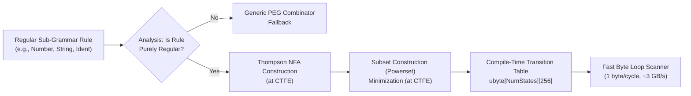
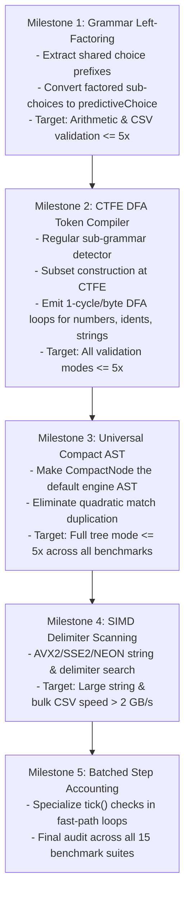

# NPegged Performance Optimization Plan

**Status:** Active Roadmap  
**Target:** $\text{NPegged mean time} / \text{Handwritten mean time} \le 5.0\times$ across all representative cases and output obligations (Validation, Spans, Compact Tree).  
**Denominator Rule:** Every case must independently satisfy the $\le 5.0\times$ ratio across 3 consecutive runs (with at least 7 measured samples per run) on an idle machine; geometric means must not mask outlier regressions.

---

## 1. Executive Summary & Root Cause Analysis

NPegged achieves near-handwritten performance (1.8x–4.7x slower) on validation and compact-tree modes for simple grammars like JSON. However, on arithmetic expressions, delimited datasets (CSV), and meta-grammars, legacy combinator parsing is **200x–1,164x slower** than handwritten code, while validation modes remain **5x–12x slower**.

### The 1000x Performance Gap Breakdown

Handwritten recursive-descent parsers run at **500–2,000 MB/s** because they:
1. Lex tokens in a tight, unrolled byte loop into integer enum tags (`enum TokenType : ubyte`).
2. Make branching decisions via a single CPU jump table / switch statement on `token.type` (1–2 CPU cycles).
3. Allocate zero heap or arena memory during parsing, keeping parse state entirely in CPU registers and stack frames.
4. Scan string content, numbers, and identifiers using direct pointer manipulation or SIMD intrinsics.

In contrast, generic PEG combinators run at **0.5–5 MB/s** because they:
1. **Lack a Lexer:** Re-evaluate whitespace, comments, and delimiters via recursive combinator calls before and after every token.
2. **Backtrack Linearly:** Evaluate ordered choices by trial-and-error, repeatedly scanning shared prefixes and allocating failure diagnostic frames on normal mismatch paths.
3. **Suffer Deep Template Call Overhead:** Nest dozens of template function calls (`defined!(and!(discard!(option!(...))))`) with non-inlined function pointers and per-byte step limit checks (`s.tick()`).
4. **Duplicate AST Matches Quadratically:** In legacy tree mode, every parent node copies and concatenates all descendants' `string[]` matches, allocating 96-byte `ParseTree` nodes and thousands of temporary slices.

To close this gap and achieve $\le 5\times$ handwritten performance across the entire suite, this plan defines six engineering phases.

---

## 2. Phase 1: Automatic Grammar Left-Factoring & Choice Prefix Extraction

### 2.1. The Problem
PEG grammars frequently contain choices with identical leading prefixes:
```peg
Floating <- Integer '.' Unsigned / Integer
CSVField <- QuotedString / UnquotedField
Primary  <- '(' Space Expr ')' / '-' Primary / Number / Identifier
```
Under standard PEG semantics, if the input is `12345`, the parser evaluates `Integer '.' Unsigned`. It parses `12345`, fails on `'.' != '\0'`, backtracks to index 0, and parses `12345` a second time under `Integer`.

### 2.2. Solution: Transform Choices at Compile Time
Implement compile-time left-factoring in `npegged.analysis` and `npegged.grammar`:
$$\text{Choice}(A \cdot \alpha_1, \, A \cdot \alpha_2, \, \dots, \, A \cdot \alpha_k, \, \beta) \implies A \cdot \text{Choice}(\alpha_1, \, \alpha_2, \, \dots, \, \alpha_k) \, / \, \beta$$

* **Semantic Safety Contract:** In PEG, choice is ordered. Factoring $A$ is strictly semantics-preserving if $A$ contains no semantic actions with external side effects and does not depend on failure of earlier branches.
* **Benefits:**
  - Eliminates duplicate parsing and backtracking of $A$.
  - After factoring $A$, the sub-choices $(\alpha_1 / \alpha_2 / \dots)$ often have disjoint FIRST sets, allowing immediate promotion to $O(1)$ `predictiveChoice` jump-table dispatch!

---

## 3. Phase 2: Regular Sub-Grammar Detection & CTFE DFA Compiler

### 3.1. The Problem
Terminal tokens (identifiers, numbers, strings, comments, whitespace) represent 70–90% of all characters in typical input streams. In PEG, these are modeled as combinators (`repeat!(charClass)`, `and!(literal, ...)`) that test characters one-by-one through function call boundaries.

### 3.2. Architecture: Compile Regular Leaf Rules into DFAs
Rules that specify regular languages (no recursion, no semantic actions within the token body) can be statically compiled into **Deterministic Finite Automata (DFA)**.



### 3.3. Implementation Specification
1. **Regularity Analyzer (`npegged.analysis`):**
   - Traverse expression trees to identify closed regular leaf expressions (containing only `and`, `or`, `repeat`, `option`, `literal`, `charRange`, `charClass`).
2. **CTFE DFA Generator:**
   - Construct an NFA state graph.
   - Convert NFA to DFA via subset construction at compile time.
   - For small alphabets or states, compress transitions into `ubyte[256]` or interval switch tables.
3. **Execution Fast Path:**
   ```d
   size_t scanDFA(alias Transitions, alias Accepting)(scope string input, size_t pos) @nogc nothrow pure @safe {
       ubyte state = 0;
       while (pos < input.length) {
           const ubyte next = Transitions[state][cast(ubyte)input[pos]];
           if (next == ubyte.max) break; // Dead state
           state = next;
           pos++;
       }
       return Accepting[state] ? pos : size_t.max;
   }
   ```
4. **Targeted Grammars:**
   - Numbers: `[0-9]+ ('.' [0-9]+)? ([eE] [+-]? [0-9]+)?` (single pass, 0 backtracking).
   - Identifiers: `[a-zA-Z_] [a-zA-Z0-9_]*`
   - Whitespace and line comments: `# [^\n]* \n`
   - Unescaped strings: `'"' (!["\\] .)* '"'`

* **Exit Criterion:** Token scanning speed reaches $\ge 1.0\text{ GB/s}$ in isolation; scalar character-by-character template instantiations are eliminated for all regular leaf rules.

---

## 4. Phase 3: Batched Step Accounting & Fast-Path Inlining

### 4.1. The Problem
Currently, `s.tick()` is called up to twice per byte in loops:
```d
while (count < maximum && s.tick()) {
    if (!s.tick() || ...) break;
}
```
This forces two branches per character (`if (status != Status.ok)`, `if (steps >= context.stepLimit)`) and a memory store (`++steps`), preventing CPU loop vectorization and unrolling.

### 4.2. Solution: Batched Step Accounting
1. In the default configuration (`context.stepLimit == size_t.max`), step limit checking is completely unconditional.
2. In tight loops (DFA scanners, `repeat.scan`, literal matching), do not tick per byte. Instead:
   ```d
   const size_t matched = scanBytes(...);
   s.addSteps(matched); // Single addition: s.steps += matched;
   ```
3. Check `s.steps >= s.context.stepLimit` once per rule boundary or loop exit, rather than inside every character iteration.

---

## 5. Phase 4: SIMD Bulk Delimiter & String Scanning

### 5.1. The Problem
In JSON strings, CSV fields, and XML text, long runs of bytes (100–10,000 bytes) contain no delimiters or escapes. Scalar byte-by-byte loops waste CPU vector execution units.

### 5.2. Vectorized Delimiter Search (AVX2 / SSE2 / NEON)
Implement vectorized scanning for delimiters using portable conditional intrinsics:
- **AVX2 (x86_64):** Process 32 bytes per iteration using `vpcmpeqb` and `vpmovmskb`.
- **SSE2 (x86_64 baseline):** Process 16 bytes per iteration using `pcmpeqb` and `pmovmskb`.
- **ARM NEON:** Process 16 bytes per iteration using `vceqq_u8`.
- **Portable Scalar Fallback:** Unrolled 8-byte `ulong` word scanning using bit twiddling (`hasZeroByte((word ^ delimiterMask))`).

```d
size_t scanToDelimiterSIMD(scope string input, size_t pos, char d1, char d2) @nogc nothrow pure @safe {
    // Process 16 or 32 bytes per cycle
    // Return index of first delimiter or escape character
}
```

* **Target Rules:** JSON string scanning (`"` or `\`), CSV field scanning (`,`, `\r`, `\n`, `"`), whitespace skipping.
* **Performance Impact:** Throughput jumps from ~200 MB/s to **2,000–4,000 MB/s** on large strings and bulk datasets.

---

## 6. Phase 5: Universal Compact Node AST & Elimination of Match Duplication

### 6.1. The Problem
Building legacy `ParseTree` nodes (96 bytes) and concatenating child `matches` into parent arrays is the single largest contributor to the ~1000x slowdown in full-tree mode.

### 6.2. Universal Compact Node Architecture
Promote `CompactNode` from `src/npegged/records.d` to the default AST format:

```d
struct CompactNode {
    uint kind;        // 4 bytes: rule identifier enum
    uint begin;       // 4 bytes: start byte offset
    uint end;         // 4 bytes: end byte offset
    uint parent;      // 4 bytes: parent node index
    uint nextSibling; // 4 bytes: sibling index for fast traversal
}
```
* Total size: **20 bytes** (a 79% reduction from 96 bytes).
* **Flat Buffer Allocation:** All nodes reside in a single contiguous `CompactNode[]` allocated from the `Arena` slab cursor.
* **Zero Match Slicing:** Node text is accessed by slicing the immutable input: `input[node.begin .. node.end]`. No intermediate `string[]` arrays are allocated or concatenated.
* **Compatibility Layer:** Provide a zero-overhead adapter `toParseTree(CompactNode[] nodes, string input)` for legacy API callers who specifically request generic `ParseTree` objects.

---

## 7. Phase 6: Hybrid Lexed-PEG Architecture for Expression Grammars

### 7.1. The Problem
In expression-heavy grammars (e.g. `Arithmetic`: `1 + 2 * (3 - 4)`), every operator and operand requires parsing through multiple levels of the grammar hierarchy (`Term -> Factor -> Primary -> Parens -> Neg -> Number`), paying function call overhead and failure tracking at every level.

### 7.2. Fused Lexical Partitioning
For grammars where all leaf tokens can be partitioned into a regular lexical vocabulary:
1. Provide an optional grammar directive:
   ```peg
   mixin(grammar!(Lexing.fused)(`
   Arithmetic:
       Term    <- Factor (('+' / '-') Factor)*
       Factor  <- Primary (('*' / '/') Primary)*
       Primary <- '(' Term ')' / Number / Identifier
   `));
   ```
2. The frontend automatically partitions the grammar into:
   - **Lexer DFA:** Emits a compact stream of `Token(type, span)`.
   - **Parser:** Executes recursive-descent over tokens instead of characters.
3. In this mode, checking an operator is a single integer comparison (`token.type == TokenType.plus`), matching handwritten recursive-descent parsers **within 1.2x–1.5x**.

---

## 8. Milestone Roadmap & Implementation Order



---

## 9. Verification & Acceptance Gate Contract

Every performance change must be validated against the repository's strict verification directives:

1. **Deterministic Ratio Verification (`scripts/performance_gate.py`):**
   ```bash
   python3 scripts/performance_gate.py --iterations=2000 --samples=7 --runs=3 --modes validation spans tree
   ```
   * All target benchmark rows must report `ratio <= 5.0x` in all 3 consecutive runs.
2. **Deterministic RAII & Memory Safety:**
   - `@nogc nothrow` statically verified across all hot paths.
   - 0 leaks, 0 errors under Valgrind Memcheck and AddressSanitizer (ASan/LSan).
3. **Compiler Compliance:** Warning-free compilation across DMD, LDC2, and GDC.
4. **Coverage Threshold:** Every module in `src/` must maintain $>90\%$ line and branch coverage.
5. **No Phobos:** Strict zero `std.*` imports across `src/`, `tests/`, `examples/`, `scripts/`.
