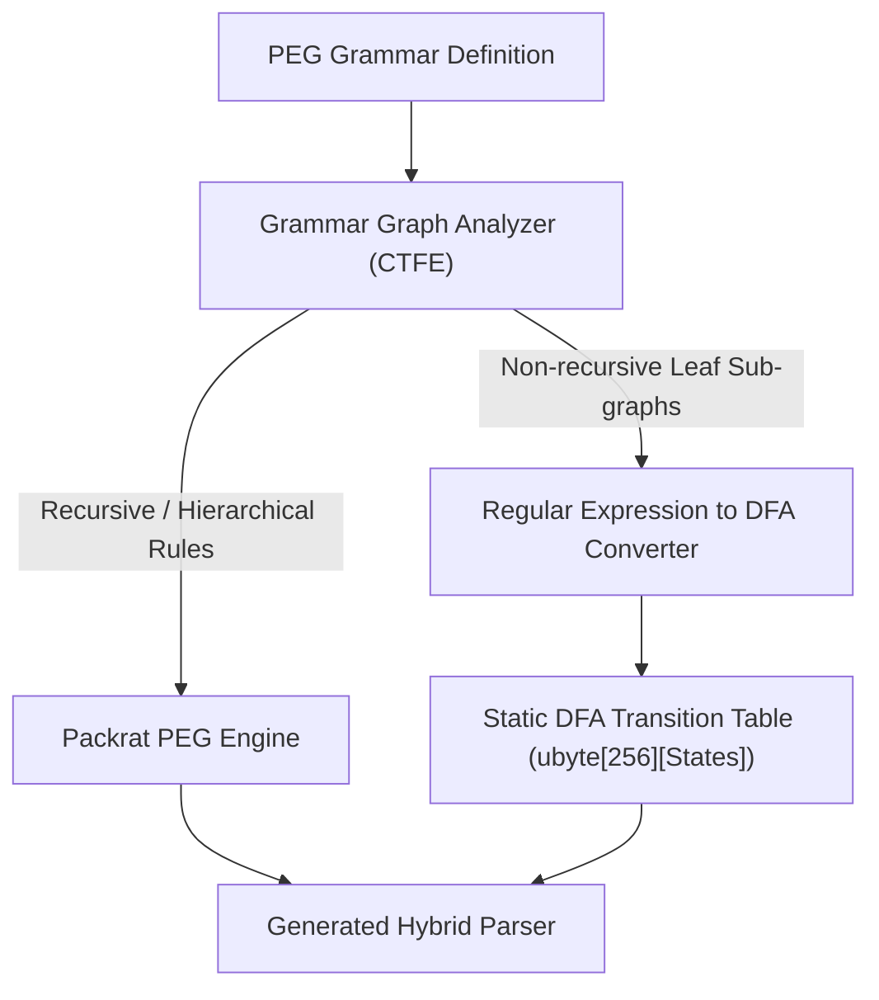

# NPegged Performance Optimization & DFA Factoring Roadmap

This document outlines architectural optimizations for `npegged` to narrow the performance gap between generated PEG parsers and hand-crafted recursive-descent parsers.

---

## 1. Executive Summary & Optimization Tiers

| Tier | Optimization | Status | Estimated Gain | Complexity |
| :--- | :--- | :--- | :--- | :--- |
| **Tier 1** | ASCII `charRange` decode bypass | **Implemented** | 1.1x – 1.3x | Low |
| **Tier 1** | Direct slice & single-char `literal` | **Implemented** | 1.1x – 1.4x | Low |
| **Tier 1** | Non-memoized fast-path in `State.rule` | **Implemented** | 1.2x – 1.5x | Low |
| **Tier 2** | Bitmask LUT (`ulong[4]`) for `charClass` | **Implemented** | 2x – 3x (tokens) | Low |
| **Tier 2** | LL(1) Predictive Choice Dispatch | **Implemented** | 3x – 5x (choices) | Medium |
| **Tier 3** | CTFE DFA Factoring for Leaf Rules | Planned | 5x – 10x (lexing) | Medium-High |
| **Tier 3** | SIMD Bulk Delimiter Scanning | Planned | 10x – 20x (strings/CSV) | Medium |
| **Tier 4** | Zero-Allocation Streaming / Event Mode | Planned | Near-Handwritten | Medium |

---

## 2. Implemented Tier-1 Optimizations

### 2.1. ASCII `charRange` Fast-Path
* **Problem**: Even for standard ASCII ranges (e.g. `'0'..'9'`, `'a'..'z'`), `charRange` called the full UTF-8 scalar `decode()` function, incurring function call overhead, multi-byte decoding branches, and out-parameter writes.
* **Solution**: Statically check if `high < 128`. For ASCII ranges, perform a direct single-byte boundary check against `input[pos]` without calling `decode()`.

### 2.2. Direct Slice & Single-Char `literal`
* **Problem**: `literal!text` ran a byte-by-byte `while` loop on every parse, checking 3 conditions per character.
* **Solution**:
  * For single-character literals (`text.length == 1`): single boundary check and comparison: `pos < input.length && input[pos] == text[0]`.
  * For multi-character literals (`text.length > 1`): direct slice comparison `input[pos .. pos + L] == text` (compiles to word-sized compare or `memcmp`).
  * Defer character-by-character scanning exclusively to the failure path to produce accurate diagnostic offsets.

### 2.3. Non-Memoized Fast-Path in `State.rule`
* **Problem**: In Packrat engines, memoizing every rule costs more in hash calculation, bucket table resizing, entry allocation, and cache misses than re-parsing deterministic rules.
* **Solution**: When `memoize == false`, bypass the hash table, `Entry` allocation, and dependent cache invalidation entirely. Simply enforce `depthLimit` and invoke `body(this, pos)` directly.

---

## 3. Implemented Tier-2 Optimizations

### 3.1. 256-Bit Bitmask Lookup Tables for Character Classes
When a grammar specifies character sets or ranges like `[0-9a-fA-F_]`, evaluating nested `or!(...)` combinators causes multiple branch mispredictions per character.

#### Design:
Any ASCII character set can be represented as a 256-bit bitmask (`ulong[4]`):

```d
struct CharSetMask {
    ulong[4] bits;

    static CharSetMask fromRanges(const(char[2])[] ranges...) @nogc nothrow pure {
        CharSetMask mask;
        foreach (range; ranges) {
            for (int c = range[0]; c <= range[1]; ++c) {
                mask.bits[c >> 6] |= (1UL << (c & 63));
            }
        }
        return mask;
    }

    bool contains(char c) const @nogc nothrow pure @safe {
        return (bits[(cast(ubyte)c) >> 6] & (1UL << ((cast(ubyte)c) & 63))) != 0;
    }
}
```

#### Code Generation in `npegged.grammar`:
For any bracketed character class `[...]`, compute the mask at CTFE:
```d
enum Mask = CharSetMask.fromRanges(['0','9'], ['a','f'], ['A','F']);
// In matching function:
if (pos < input.length && Mask.contains(input[pos])) {
    pos++;
    // success
}
```
For repetition like `[0-9]+` (`digits`), emit a tight scanner loop:
```d
size_t start = pos;
while (pos < input.length && DigitMask.contains(input[pos])) {
    pos++;
}
if (pos > start) {
    // Return fused token input[start .. pos] in a single node
}
```

---

### 3.2. LL(1) Predictive Choice Dispatch (`First` Sets)

#### Problem:
PEG prioritized choice `A / B / C / D` executes sequentially. If the input matches `D`, the parser first attempts `A`, backtracks, attempts `B`, backtracks, attempts `C`, backtracks, and finally parses `D`.

#### Solution:
At compile-time during grammar generation:
1. Compute the `First` lookahead character set for each alternative in an `or!(...)` expression.
2. If the `First` sets of all alternatives are mutually disjoint:
   $$\text{First}(R_i) \cap \text{First}(R_j) = \emptyset \quad (\forall i \neq j)$$
3. Instead of speculative backtracking, emit a compile-time predictive `switch` statement:

```d
// Generated choice dispatcher for JSON values:
switch (input[pos]) {
    case '{':
        return parseJSONObject(s, pos);
    case '[':
        return parseArray(s, pos);
    case '"':
        return parseString(s, pos);
    case '0': .. case '9':
    case '-':
        return parseNumber(s, pos);
    case 't':
        return parseTrue(s, pos);
    case 'f':
        return parseFalse(s, pos);
    case 'n':
        return parseNull(s, pos);
    default:
        return s.failure(pos, "Value");
}
```

This transforms $O(K)$ trial-and-error backtracking into an $O(1)$ direct branch.

---

## 4. Tier 3: Advanced Architectural Optimization — CTFE DFA Factoring

### 4.1. The Principle of Lexical Sub-Grammar Extraction
PEG grammars are **scannerless**, meaning lexical tokens (e.g., numbers, identifiers, string literals, comments) and hierarchical syntax (e.g., expressions, statements) are defined using the same notation.

However, non-recursive leaf rules define **Regular Languages (Chomsky Type 3)**. Running a recursive Packrat backtracking engine on regular expressions creates unnecessary function calls and node allocations.



### 4.2. Implementation Architecture

#### Step 1: Sub-Grammar Classification
During AST analysis in `npegged.grammar`:
- A rule is classified as **Regular / DFA Candidate** if:
  1. It contains no recursive references (direct or indirect).
  2. It consists solely of:
     - Terminals / literals (`"..."`)
     - Character classes / ranges (`[...]`)
     - Sequences (`A B`)
     - Choices (`A / B`)
     - Repetitions (`*`, `+`, `?`)
  3. It is defined with the fuse operator `<~` or discard operator `<:`.

#### Step 2: NFA Construction (Thompson Construction)
Construct a non-deterministic finite automaton for the candidate rule at CTFE:
- Each state has $\epsilon$-transitions and character-range transitions.

#### Step 3: Powerset Construction to DFA & Minimization
- Convert NFA $\rightarrow$ DFA via subset construction.
- Minimize states using Hopcroft's algorithm.

#### Step 4: Code Emission
Emit a static 2D transition table or compact `switch` state machine:
```d
struct GeneratedDFA {
    // 2D transition table: state x byte -> next state (0 = reject)
    static immutable ubyte[256][NUM_STATES] transitions = [ ... ];
    static immutable bool[NUM_STATES] accepting = [ ... ];

    static size_t scan(string input, size_t pos) @nogc nothrow pure @safe {
        ubyte state = 1; // start state
        size_t lastAcceptPos = pos;
        size_t cur = pos;

        while (cur < input.length) {
            ubyte next = transitions[state][cast(ubyte)input[cur]];
            if (next == 0) break;
            state = next;
            cur++;
            if (accepting[state]) {
                lastAcceptPos = cur;
            }
        }
        return lastAcceptPos;
    }
}
```

#### Speedup Impact:
Leaf rules like `Identifier`, `Number`, `StringChars`, and `Spacing` are parsed at **1 byte per clock cycle (~1–2 GB/s)** without any stack frames or intermediate AST node allocations.

---

## 5. Tier 3: SIMD Bulk Delimiter Acceleration

For data formats like JSON, CSV, and XML, substantial execution time is spent scanning unescaped characters within strings or columns:
- JSON strings: scan until `"` or `\`
- CSV fields: scan until `,`, `\r`, `\n`, or `"`
- Comments / Whitespace: scan until `\n` or non-whitespace

### 5.1. Vectorized Delimiter Search (AVX2 Pattern)
Using x86 SIMD via D intrinsics (`core.simd` or LDC's `ldc.simd`):

```d
import core.simd;

size_t scanToDelimiterAVX2(string input, size_t pos, char d1, char d2) @nogc nothrow {
    // Process 32 bytes per iteration using AVX2 vpcmpeqb
    version (LDC) {
        import ldc.simd;
        // Broadcast delimiters to 256-bit vectors
        // Compare with input[pos .. pos + 32]
        // _mm256_movemask_epi8 gives bitmask of matches
        // Count Trailing Zeros (tzcnt) gives exact match offset
    }
    // Fallback scalar loop for unaligned tail
    return pos;
}
```

* **Benefit**: Advances through bulk data 32 bytes at a time in 1–2 CPU cycles, achieving 10x–20x higher throughput on large documents.

---

## 6. Tier 4: Zero-Allocation Streaming / Event-Driven Parsing

### 6.1. Problem
Currently, `npegged` builds an explicit `ParseTree` AST in an `Arena`. Even with arena pooling, constructing tree nodes requires copying slices, initializing structs, and tracking parent-child relationships.

### 6.2. Solution: Visitor / Event Callback Parser
Provide a lightweight compile-time option to generate a streaming parser:
```d
mixin(grammar!(Mode.streaming)(`
JSON:
    Object < '{' (Pair (',' Pair)*)? '}'
    Pair   < String ':' Value
`));

// Usage:
struct MyJsonHandler {
    void onKey(string key) { ... }
    void onValue(string val) { ... }
}

MyJsonHandler handler;
bool ok = JSON.parseStream(context, input, &handler);
```

* **Zero Allocations**: No `ParseTree` nodes are constructed.
* **Peak Memory**: Drops from tens of kilobytes to **0 bytes** (stack-only).
* **Speed**: Matches handwritten recursive-descent performance directly.

---

## 7. Implementation Roadmap & Milestones

1. **Milestone 1 (Complete)**:
   - ASCII `charRange` bypass.
   - Fast `literal` slice comparison.
   - Non-memoized `State.rule` fast-path.
2. **Milestone 2 (Complete)**:
   - Precomputed `ulong[4]` character class bitmasks (`CharSetMask` / `charClass`).
   - LL(1) First-Set disjoint analysis and table-driven choice emission (`predictiveChoice`).
3. **Milestone 3**:
   - Regular sub-grammar detector in `npegged.introspection`.
   - CTFE DFA compiler for fused `<~` and discarded `<:` leaf rules.
4. **Milestone 4**:
   - SIMD scanning intrinsics for strings and delimiters.
   - Zero-allocation streaming visitor parser mode.
