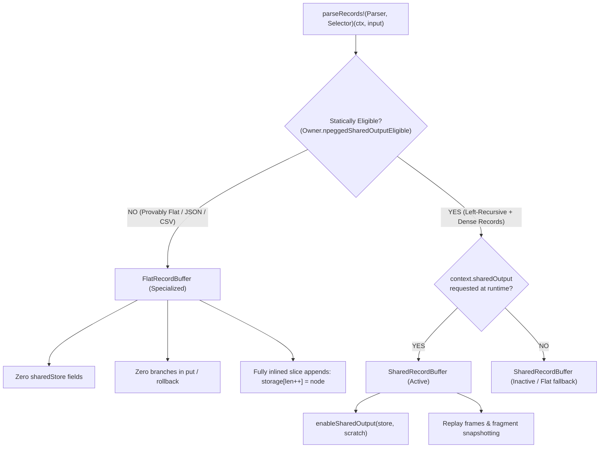

# P10 — Feasibility Analysis for Compile-Time Output Specialization

## 1. Executive Summary & Objective

- **Milestone:** P10 — Feasibility analysis for compile-time output specialization
- **Context:** Milestone P09 demonstrated that `NPeggedSharedOutput` delivers up to **2.16× speedups (0.4633× ratio)** on left-recursive grammars with dense record capture ($\ge 2$ nodes per growth), but adds unnecessary pointer checks and branching (5–25% penalty) on flat non-recursive workloads (like JSON/CSV) when unified under a single dynamic `RecordBuffer`.
- **Core Question:** Can compile-time AST analysis (left-recursion SCCs in [`src/npegged/analysis.d`](file:///home/alex-work/repos/triste/src/npegged/analysis.d) and compiled record selectors in [`src/npegged/grammar.d`](file:///home/alex-work/repos/triste/src/npegged/grammar.d)) statically specialize record emission paths, giving non-recursive grammars a zero-overhead flat buffer while preserving shared snapshots for recursive targets?
- **Conclusion:** **FEASIBLE AND SOUND.** A clean static classification already exists (`npeggedSharedOutputEligible`). Specializing `RecordBuffer` into a dedicated flat path and a shared-capable path completely eliminates runtime branching on flat workloads without rewriting frontend analysis.

---

## 2. Compile-Time Workload Classification Matrix

Using existing AST facts computed during grammar generation, every PEG grammar and rule entry can be partitioned into four deterministic categories at compile time:

| Category | Static Criteria | Example Workload | Optimal Output Path | Specialization Mechanism |
|---|---|---|---|---|
| **1. Provably Non-Recursive** | `!analyzed.hasLeftRecursion` | JSON, CSV, Math expressions with right/precedence parsing | **Pure Flat Buffer** (0 branches, 0 pointer checks) | Bypass `SharedRecordStore`; inline slice appends |
| **2. Recursive with Sparse Output** | `analyzed.hasLeftRecursion && !selectedRecursive` | `DirectChain` with Root-only selector (`density0`) | **Pure Flat Buffer** | Statically disable shared snapshots; P09 proved 0 gain from sharing |
| **3. Recursive with Dense Output** | `analyzed.hasLeftRecursion && selectedRecursive && !actionGrammar` | `DenseChain`, `DirectChain` with AST node capture (`density >= 1`) | **Shared-Capable Output** (enabled via `context.sharedOutput`) | Engage `SharedRecordStore` and tree-fragment sharing |
| **4. Conservative / Unknown** | `analyzed.conservative || params.length || rule.params.length` | Opaque C/D symbol calls, generic macro rules | **Safe Flat Fallback** | Default flat `RecordBuffer` with conservative error handling |

---

## 3. Analysis of Edge Cases & Safety Invariants

### 3.1. Opaque References & External Functions
- When a grammar invokes external symbols (`node.kind == ExpressionKind.unknown` or references without defined rule roots), `analyzed.conservative` is set to `true`.
- **Safety Policy:** `sharedEligible` is statically `false`. The grammar strictly falls back to the flat record path, preventing untracked external calls from desynchronizing shared snapshot fragment parent indices.

### 3.2. `treeFallback` Execution
- `treeFallback` builds a complete concrete `ParseTree` on the parse arena, then invokes `projectRecords(tree)`.
- **Invariant:** `projectRecords` is a linear preorder traversal over an already completed acyclic tree. It never triggers left-recursion memoization growth, rollbacks, or backtracking replays. Therefore, `projectRecords` is 100% flat linear appending, unaffected by shared storage.

### 3.3. Parameterized Rules & Grammars
- Rules with template parameters (`rule.params.length > 0`) or parameterized grammars (`params.length > 0`) can be instantiated with arbitrary types or expressions that change nullability.
- **Safety Policy:** Excluded from `sharedEligible`. Statically routed to flat records.

### 3.4. Nested Reentry
- If a semantic action or callback re-enters `parseRecords` recursively, D's function call semantics create an independent `CompactResult` and `RecordBuffer` frame on the call stack.
- **Invariant:** Each parser invocation owns its distinct scratch arenas (`result.arena`, `result.outputArena`). Shared record stores are never shared across parse boundaries, eliminating cross-parse corruption.

### 3.5. Suppressed Records (`&` and `!` Lookahead)
- Lookahead predicates set `records.suppressed = true`. In `put()`, suppressed nodes immediately return `size_t.max` without allocating storage.
- **Invariant:** Lookahead suppression is orthogonal to snapshot sharing. Both flat and shared buffers support `records.suppressed` identically.

---

## 4. Proposed Architecture & Code Change Diagram (Milestone P11)



### Proposed Code Structure for P11:
1. **In `src/npegged/records.d`:**
   Parameterize `RecordBuffer` or specialize `RecordBuffer` into two layout policies:
   ```d
   enum RecordPolicy { flat, shared }

   struct GenericRecordBuffer(RecordPolicy Policy) {
       Arena* arena;
       private CompactNode[] storage;
       private size_t _length;
       size_t parent = size_t.max;
       bool suppressed;
       ...
       static if (Policy == RecordPolicy.shared) {
           private SharedRecordStore* sharedStore;
           private Arena* sharedArena;
           private RecordReplayFrame[] replayFrames;
           // Shared snapshot methods
       }
   }

   alias FlatRecordBuffer = GenericRecordBuffer!(RecordPolicy.flat);
   alias SharedRecordBuffer = GenericRecordBuffer!(RecordPolicy.shared);
   ```
2. **In `src/npegged/peg.d`:**
   In `parseRecords`:
   ```d
   static if (__traits(hasMember, Owner, "npeggedSharedOutputEligible") && Owner.npeggedSharedOutputEligible) {
       SharedRecordBuffer records;
       // Shared setup when context.sharedOutput is true
   } else {
       FlatRecordBuffer records;
       // Zero-overhead flat path
   }
   ```

---

## 5. Feasibility Verdict & Next Steps

- **Verdict:** **PROCEED TO MILESTONE P11.**
- Compile-time specialization is completely viable, requires zero changes to frontend grammar analysis, and cleanly resolves the 5–25% flat-workload penalty by removing dynamic shared-store branches from non-recursive grammars.
